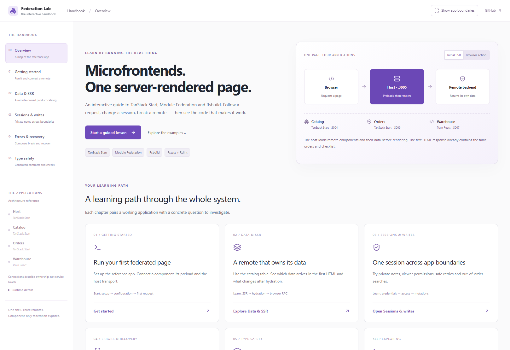
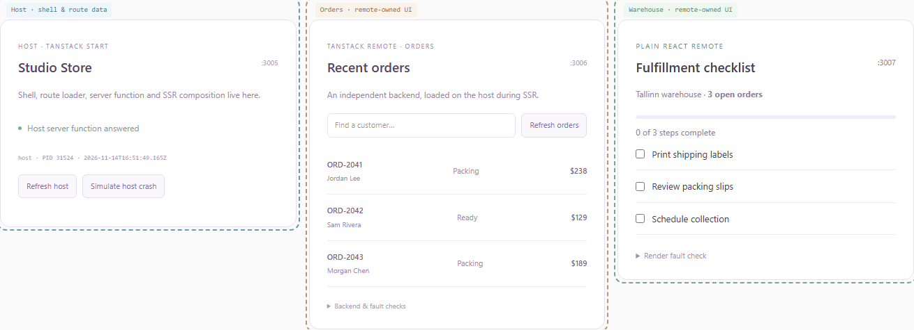

# Federation Lab

An interactive reference app for **TanStack Start + Module Federation + Rsbuild**:
one host, two TanStack Start remotes, and one plain React remote.
Remote components call their own private server functions through the host. Federation
exposes component modules; server-function modules are never exposed directly.

The handbook combines live examples, SSR-highlighted code, ownership outlines, and
reproducible checks with **Rstest**, **Rslint**, **shadcn/ui**, and **TanStack Table**.

## Run locally

Use a Node.js version supported by [package.json](package.json): Node 22 (22.18+), Node 24 (24.11+),
or Node 26+. The reference was validated with Node 24.22.1 and npm on Windows.
Ports **3004–3007** must be available. The build downloads generated types from temporary local remote previews.

```sh
git clone https://github.com/mes113/tanstack-start-federation-lab.git
cd tanstack-start-federation-lab
npm ci
npm run build
npm run dev
```

Open **[the handbook overview](http://127.0.0.1:3005/guide)**.
The build prepares remote containers, generated route trees and type archives.
Development starts the remotes before the host. Stop with Ctrl+C in the terminal
that started the app. To preview built artifacts, stop dev and run `npm run preview`.



## Explore the handbook

| Topic             | Local route                                               | What it demonstrates                                                                       |
| ----------------- | --------------------------------------------------------- | ------------------------------------------------------------------------------------------ |
| Overview          | [/guide](http://127.0.0.1:3005/guide)                     | Architecture, learning path and source map.                                                |
| Getting started   | [/getting-started](http://127.0.0.1:3005/getting-started) | Setup, remote registration and the first request.                                          |
| Data & SSR        | [/](http://127.0.0.1:3005/)                               | A 96-product catalog with remote-owned filtering, sorting, pagination and CSV export.      |
| Sessions & writes | [/scenarios](http://127.0.0.1:3005/scenarios)             | Signed sessions, private notes, permissions, retries, version conflicts and request races. |
| Errors & recovery | [/lab](http://127.0.0.1:3005/lab)                         | Three remotes, fault injection, isolated fallbacks and recovery.                           |
| Type safety       | [/types](http://127.0.0.1:3005/types)                     | Generated props and preload declarations, plus separate runtime DTO checks.                |

Each topic has **Example / Code / Tests** views. Switching views preserves the mounted
example. Tabs support arrow keys, Home and End; the mobile menu offers the same topics.
Tests shows commands and expected behavior, rather than executing commands in the browser.

**Show app boundaries** labels host and remote UI ownership. The setting survives client
navigation and resets on reload. The sidebar identifies the apps used by the example;
Runtime details lists their ports. Neither feature is a live service-health monitor.



Follow the [hands-on walkthrough](docs/WALKTHROUGH.md) for actions and expected results.

## How it works

| Application | Local origin                                  | Ownership                                                                |
| ----------- | --------------------------------------------- | ------------------------------------------------------------------------ |
| Host        | [127.0.0.1:3005](http://127.0.0.1:3005/guide) | Handbook, loaders, SSR composition and server-function forwarding.       |
| Catalog     | [127.0.0.1:3004](http://127.0.0.1:3004/)      | TanStack Start table, catalog backend and component-owned preload.       |
| Orders      | [127.0.0.1:3006](http://127.0.0.1:3006/)      | TanStack Start orders panel, private notes, authorization and mutations. |
| Warehouse   | [127.0.0.1:3007](http://127.0.0.1:3007/)      | Plain React checklist: SSR inside the host, CSR when opened standalone.  |

On a page request, the host loads a remote component module, calls its preload, and
renders the returned data into HTML. Hydration reuses that data. Browser interactions
call the remote's private server function through the host's namespaced gateway, for
example `POST /_federation/catalog/_serverFn/<id>`.

The host consumes generated declarations from all three remotes. Props, loader inputs,
DTOs and the SSR wrapper are type checked without handwritten remote module shims.
See [architecture and contracts](docs/ARCHITECTURE.md) for the request paths and source map.

## Verify locally

Stop dev first. E2E tests own ports **3004–3007 and 3016** and deliberately restart apps.

```sh
npx playwright install chromium
npm test
npm run test:dev
npm run typecheck
npm run lint
npm run format:check
```

The latest complete verification on 2026-11-14 passed **36 production tests** and
**35 development tests with one intentional deployment skip**. Type checking, Rslint
and formatting also passed. These are recorded local results, not live CI status.

Focused commands: `npm run test:unit`, `npm run test:multi`,
`npm run test:multi:dev`, and `npm run test:advanced`.
[TESTING.md](TESTING.md) explains coverage, assertions, artifacts and limitations.

## Documentation

- [Walkthrough](docs/WALKTHROUGH.md): try each topic, observe failures, and recover.
- [Architecture](docs/ARCHITECTURE.md): SSR, transport, sessions, ownership and generated types.
- [Development](docs/DEVELOPMENT.md): commands, environment variables, source layout and troubleshooting.
- [Testing](TESTING.md): production/dev matrix, failure modes and verification evidence.
- [Contributing](CONTRIBUTING.md): fork, propose changes and understand required CI/reviews.
- [Security](SECURITY.md): report vulnerabilities privately and review the automation trust boundary.
- [Community conduct](CODE_OF_CONDUCT.md): expectations for participation.

## Scope and provenance

Alice and Bob are local demo identities, not a production login system. Notes live in
memory and reset when orders restarts. The session cookie lasts ten minutes; only that
allowlisted cookie is forwarded to orders. This reference does not implement a database,
production identity provider, CDN deployment or transparent upgrades of cached containers.

`@module-federation/tanstack` is pinned to preview commit `391f4cc` in the lockfile.
The project exercises [PR #21](https://github.com/module-federation/tanstack/pull/21)
(server-function transport, recovery and colliding IDs) and
[PR #22](https://github.com/module-federation/tanstack/pull/22) (remote type publishing
and consumption). The [original prototype](https://github.com/mes113/module-federation-ssr)
illustrates the host registry problem and the remote transport approach.

Upstream configuration/router notices are retained in [LICENSE.upstream](LICENSE.upstream).
Editable shadcn/ui primitives retain [LICENSE.shadcn](LICENSE.shadcn). The catalog uses
registry components; the handbook's [Code Block](https://ui.shadcn.com/docs/components/radix/code-block)
uses Shiki with a synchronous JavaScript regex engine so highlighted text is in the SSR HTML.
The common theme is [apps/theme.css](apps/theme.css).
