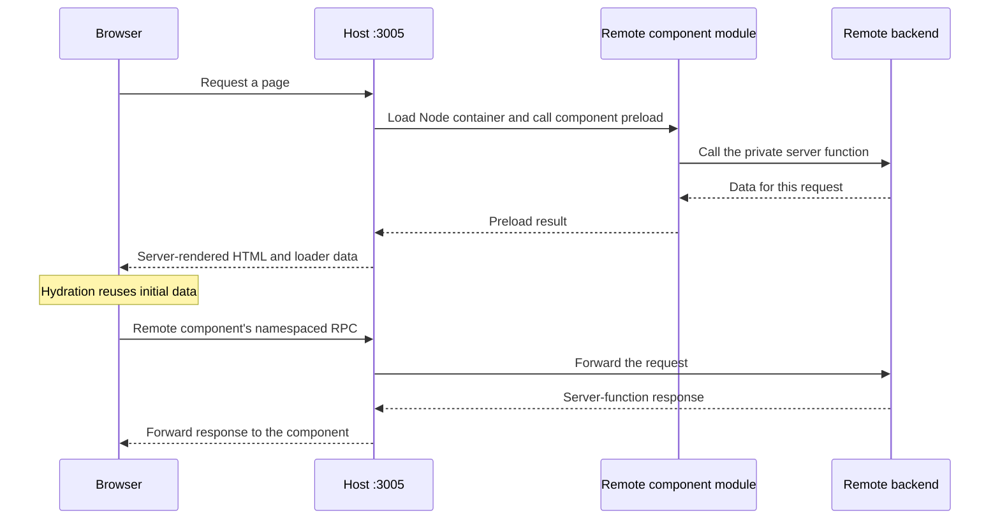

# Architecture and contracts

[Documentation home](../README.md) · [Walkthrough](WALKTHROUGH.md) · [Development](DEVELOPMENT.md) · [Test matrix](../TESTING.md)

## One host, three component modules

| App           | Expose                                                   | Initial data                        | Backend                                        |
| ------------- | -------------------------------------------------------- | ----------------------------------- | ---------------------------------------------- |
| Catalog       | `catalog/ServerPanel`                                    | `ServerPanel.preload()`             | Catalog's private Start server function.       |
| Orders        | `orders/OrdersPanel`                                     | `OrdersPanel.preload()`             | Orders' private Start server function.         |
| Private notes | The same `orders/OrdersPanel` module's `.Workspace` view | `OrdersPanel.preloadWorkspace(...)` | Orders' private workspace functions and store. |
| Warehouse     | `warehouse/WarehousePanel`                               | Props supplied by the host          | No server functions or TanStack runtime.       |

Each remote exposes one component module. Attaching a preload to that module gives the
host a typed way to request initial data. It does not expose the server-function module
or register a remote handler in the host's own function registry.

## Initial HTML and browser actions

The catalog namespace is `/_federation/catalog/_serverFn`; orders uses
`/_federation/orders/_serverFn`. The host's official `createRemoteServerFunctions`
forwarder chooses the backend by namespace. Catalog and orders intentionally use the
same source/export names for a real production function-ID collision test; their calls
still reach separate backend processes.

Read [host forwarding](../apps/host/src/start.ts),
[catalog preload](../apps/remote/src/components/ServerPanel.tsx),
[orders component exports](../apps/orders/src/components/OrdersPanel.tsx), and
[private functions](../apps/orders/src/workspace-functions.ts).

## Request correlation

The host's first middleware creates a fresh UUID for each request and keeps its
context in a request-keyed WeakMap. It ignores client-supplied IDs. Both remote
transports forward this ID as `x-lab-request-id`; backend preload metadata returns
it to the remote UI. The host also adds the ID, a fixed `x-lab-route` namespace,
and `Server-Timing: lab;dur=...` to its response. Existing headers are preserved.
Context is removed in `finally`; concurrent sessions do not share trace state.

Catalog and private notes render an expandable request trace, including in SSR
HTML. Initial timing is the backend handler duration. Later browser calls show
HTTP status and browser round-trip duration. Host timing ends when middleware
receives the response, before a streamed response body necessarily completes.
These durations measure different intervals and should not be compared as equal.

The path shows configured ownership, not distributed tracing spans or backend
health. A transport failure can happen before the backend is reached, and Start
can serialize application errors inside HTTP 200. Standalone backend requests
generate their own IDs; `viaHost` is diagnostic metadata, never authorization.
No payloads, cookie values, or query strings are included in trace IDs or headers.
This is an in-page inspection aid, without persistent logs or a tracing service.

## SSR composition and recovery

The host route loaders resolve remote modules and collect data before rendering.
[ssr-remote.tsx](../apps/host/src/components/ssr-remote.tsx) caches component code,
never request data. A resolved component renders synchronously during SSR; an unresolved
browser component can still use the federation lazy loader.

This matters during recovery: React streaming can otherwise put a resolved lazy module
inside a hidden container that requires JavaScript to reveal. The suite checks actual
visibility with JavaScript disabled, both before and after remote recovery.

The `/lab` route collects remote stylesheets for its SSR HTML. Each module has a client
error boundary and a Suspense fallback for server rendering failures. A host loader
failure renders the route error screen. Backend errors, transport timeouts and render
errors are distinct cases in [TESTING.md](../TESTING.md).

The warehouse remote has no router, Start registration or TanStack runtime dependency.
Its build reuses the federation adapter to produce compatible browser and Node containers.
Opening its own page uses `createRoot`; composing its component in the host uses SSR.

## Session and data ownership

The [host identity functions](../apps/host/src/session-functions.ts) issue a signed,
HttpOnly, SameSite=Lax `lab_session` cookie for Alice/admin or Bob/viewer. The fixture's
expiry is ten minutes. Host and orders use the same signing secret through
[the session package](../packages/lab-session/index.mjs).

Only `lab_session` is allowlisted for orders forwarding, including SSR calls. Arbitrary
cookies and Authorization headers are not forwarded. Orders verifies the signature,
expiry, known user and server-owned role independently; the browser cannot grant itself
a role or choose another user's store through request data.

Private notes are held in a per-user [in-memory store](../apps/orders/src/workspace-store.ts).
Alice can create and update her notes; Bob can read his. Missing/invalid sessions produce
401, forbidden writes 403, invalid titles 422, and stale versions or conflicting request
keys 409. Handler exceptions may instead be serialized in HTTP 200 by this pinned Start
version, so transport status alone is insufficient to infer application success.

Create requests carry idempotency keys. Repeating a successful key with the same title
returns the original result. Updates send the note's last known version. The UI guards
read state with a request sequence, so late searches cannot overwrite newer results.

These controls demonstrate transport and authorization boundaries. The local identity
selectors and default signing key are fixtures, not deployable identity management.

## Generated declarations and runtime validation

Each remote publishes `@mf-types.zip` and `@mf-types.d.ts` through its manifest. Host
builds consume these archives with `typesOnBuild` and `abortOnError`; the build runner
starts temporary remote previews while the host downloads its declarations.

[Host tsconfig](../apps/host/tsconfig.json) maps the three remote namespaces to generated
archives. There are no handwritten `declare module` shims or host imports of remote source.
`skipLibCheck` accommodates upstream generated declarations, while application contracts
are checked strictly. Build output and downloaded types are not committed.

The compile-time contracts are exercised in
[remote-types.check.tsx](../apps/host/src/remote-types.check.tsx) and
[multi-remote-types.check.tsx](../apps/host/src/multi-remote-types.check.tsx), including
negative `@ts-expect-error` cases and preservation of props through the SSR wrapper.
These files are not imported by the running app.

TypeScript does not validate an independently deployed runtime response.
[Workspace DTO validation](../apps/orders/src/workspace-contract.ts) rejects an
incompatible contract separately. The deployment test rebuilds orders while retaining
the host: a compatible release works; changed function IDs fail visibly and recover
after restoration. It does not demonstrate automatic adoption of a breaking container.

## Handbook ownership

`packages/ui` is the shared React-only workspace for editable shadcn/ui primitives.
Every application imports `@lab/ui`; no remote depends on the host's component
source. Existing host/catalog UI paths re-export the shared primitives. Styling
is compiled from the common theme, which scans this workspace and all four apps.
The plain React remote remains independent of TanStack Start at runtime.

The chapter guide separates instructions and expected behavior from observed
page-loader data. Catalog and notes render their own live result summaries.
Shadcn Tabs keep inactive examples mounted; switching to Code does not reset the
remote's filters or notes. Observations do not replace automated SSR assertions.

The host owns the navigation, chapter framing, Example / Code / Tests panels and code
examples. Catalog owns the table; orders owns its panels and notes; warehouse owns its
checklist. [HandbookShell](../apps/host/src/components/HandbookShell.tsx) and
[ChapterWorkbench](../apps/host/src/components/ChapterWorkbench.tsx) keep the learning UI
consistent without moving remote business functions into the host.

Ownership outlines and the application map are declarative labels, not service probes.
Tabs keep examples mounted; code is highlighted during SSR. Signed-session data stays
in request-local loader results, not in these UI settings or the module cache.
