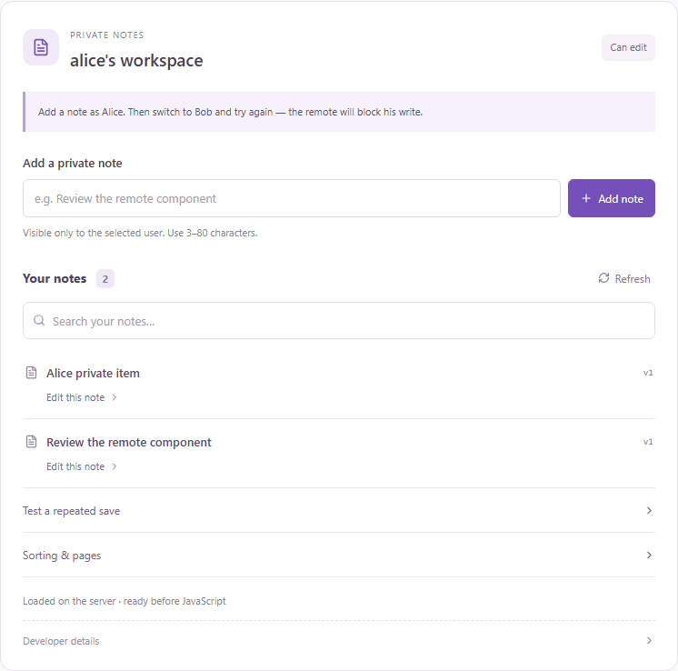

# Hands-on walkthrough

[Documentation home](../README.md) · [Architecture](ARCHITECTURE.md) · [Development](DEVELOPMENT.md) · [Test matrix](../TESTING.md)

Start the apps with the README's quickstart and open
[Overview](http://127.0.0.1:3005/guide). Use the sidebar topics or mobile menu to navigate.
Each topic pairs a question and expected result with Example, Code and Tests views.
The guided experiment gives three actions with expected results. Its labelled
page-loader snapshot is separate from the catalog's live result and the notes
app's observed HTTP response. These displays describe received data; they do not
automatically mark a scenario as passing. **See the code** opens the implementation
and moves keyboard focus to the Code tab. Tabs keep the live example mounted.
The Tests view contains terminal instructions; it does not execute tests in the browser.

## Getting started

Run `npm run doctor` after `npm ci`. If preview or tests will not start, use
`npm run doctor -- --mode preview` or `--mode test` for actionable prerequisite
checks. Startup performs the same checks and never kills an existing process.

Open [/getting-started](http://127.0.0.1:3005/getting-started) to connect the first build,
remote manifest registration, component-owned preload and host forwarding. Follow the
source paths in Code to inspect the full local implementation.

Turn on **Show app boundaries** on any topic. The host and remote UI regions receive
ownership labels. The setting follows client-side navigation and resets on reload.
The map explains participation in the example; it does not report whether a server is healthy.

## Data & SSR

Open [the catalog](http://127.0.0.1:3005/).

1. Inspect the eight initial rows and the backend identity under Connection details.
2. Search a product name or SKU, filter a category/status, sort a column, and change pages.
3. Select rows and export CSV, or export the current page.
4. Clear filters to restore the catalog.

Expect each data operation to run on the catalog backend, with browser RPCs sent through
`/_federation/catalog/_serverFn/...` on the host. Hydration should reuse the initial rows.
The automated suite verifies the initial HTML and actual visibility without JavaScript.
Switching to Code and back preserves the mounted table and its state.

## Sessions & writes

Open [private notes](http://127.0.0.1:3005/scenarios). Select a lesson, then choose an
identity. Wait until the current identity and workspace owner agree before interacting.
Alice and Bob are local fixtures; choosing them does not contact an identity provider.

| Lesson                 | Try it                                                                                           | Expected result                                                                                     |
| ---------------------- | ------------------------------------------------------------------------------------------------ | --------------------------------------------------------------------------------------------------- |
| Sessions & permissions | Choose Alice, add a note, then choose Bob and try adding one. Sign out and refresh.              | Alice writes her own notes; Bob sees his own data and gets 403 for writes; the guest read gets 401. |
| Mutations & retries    | As Alice, add a note, open Test a repeated save, then Repeat last save.                          | The same saved result is returned without adding another note.                                      |
| Stale edits            | Open the same note in two tabs, expand Edit this note in both, then save different titles.       | The first update advances the version; the older edit is rejected with 409.                         |
| Out-of-order requests  | Enter one letter in search, quickly replace it with a full word, then inspect Developer details. | The one-letter request is delayed about 750 ms; the newer search remains applied when it arrives.   |
| SSR & navigation       | Open Saved search or Descending view, use Back/Forward, then reload.                             | The URL and initial remote view agree; authenticated deep links render their data on the server.    |

Sorting & pages reveals additional controls for the race experiment. Developer details
contains applied query state, backend identity and actual HTTP history. The latest-response
summary reports transport status; it does not replace the application error message.

A renamed or newly added note may not match the active search. An empty filtered view
explains this and offers **Show all notes**. Clear also removes the search. Sign out clears
the browser session, but does not delete stored notes. Restarting orders resets its in-memory store.

## Errors & recovery

Open [/lab](http://127.0.0.1:3005/lab?fault=none). A healthy page combines host data, catalog,
orders and the plain React warehouse checklist. Activate a card, observe the affected region,
then choose **Recover all modules** to remove the injected fault.

| Card               | Expected result                                                                                                          |
| ------------------ | ------------------------------------------------------------------------------------------------------------------------ |
| Backend exception  | Orders shows an error; host, catalog and warehouse remain usable. Start can serialize the handler exception in HTTP 200. |
| Slow backend       | Orders exceeds the host's one-second forwarding timeout; its fallback appears. Browser transport failures return 502.    |
| React render error | Warehouse has a visible module fallback, including during SSR with JavaScript disabled.                                  |
| Host loader error  | A page-level error replaces the workspace. Try workspace again recovers the normal route.                                |

Use the module's diagnostic controls to trigger browser-side faults separately. Error
boundaries remount the affected component when retried. The cards inject controlled faults;
Recover cannot restart a backend that was actually stopped outside the app.

To test a real outage, run each app in a separate terminal as described in
[Development](DEVELOPMENT.md#run-one-app-at-a-time), stop orders, and refresh it while
using catalog. Restart orders and retry. Its new backend PID identifies the recovered process.

## Type safety

Open [/types](http://127.0.0.1:3005/types). Compare generated Warehouse props with runtime
workspace DTO checks, then use Code to inspect the intentionally invalid examples.

Run `npm run typecheck` after the first build. Negative examples use `@ts-expect-error`,
so a successful check means the invalid cases were rejected as expected. To exercise a real
required-prop change and incompatible runtime DTO, stop dev and run `npm run test:advanced`.
The page explains the contract; it does not embed a browser TypeScript compiler.

## What to inspect next

- [Architecture](ARCHITECTURE.md) traces both initial SSR and browser calls.
- [Development](DEVELOPMENT.md) maps features to source files and lists configuration options.
- [TESTING.md](../TESTING.md) documents cold startup, partial failures, deployment and bounded load checks.
